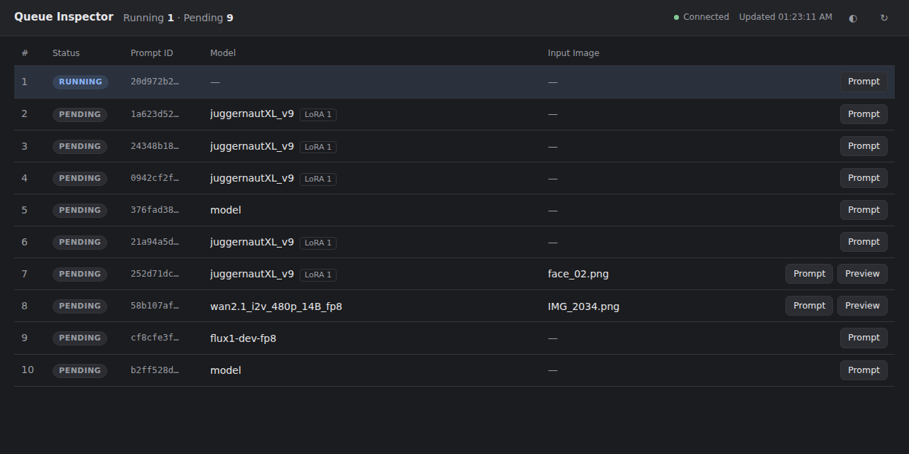
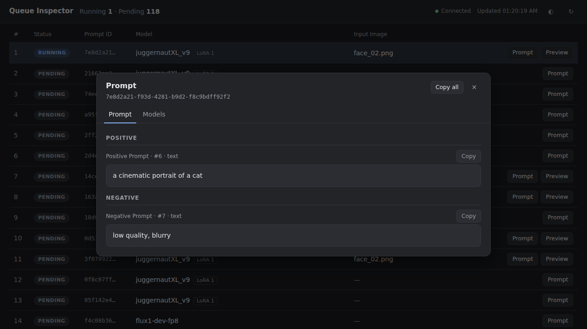
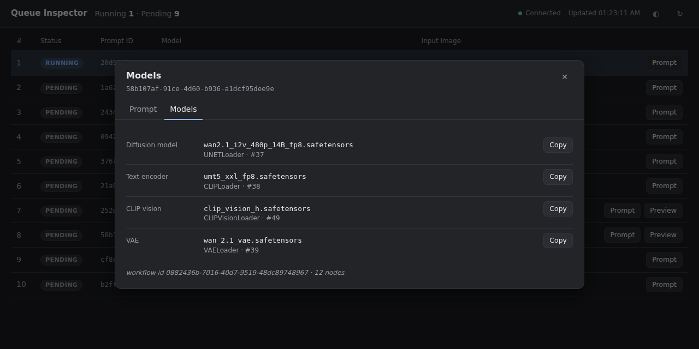

# ComfyUI Queue Inspector

ComfyUI 큐(실행 중 + 대기 중 작업)를 **읽기 전용**으로 보여주는 독립 프로그램입니다.
ComfyUI 안에 설치하지 않으므로, ComfyUI를 업데이트·재설치해도 서로 영향이 없습니다.



| 프롬프트 보기 | 모델 보기 |
|---|---|
|  |  |

## 기능

- 실행 중 작업 → 대기 작업을 **실제 실행 순서**대로 표시 (자동 새로고침 + ↻ 수동 새로고침)
- `prompt_id` 앞 8자리 표시, 클릭하면 전체 ID 복사
- **Model**: 메인 모델(Checkpoint / Diffusion model) 표시, LoRA 개수 배지. 클릭하면 LoRA(강도 포함)·Text encoder·VAE 등 전체 목록
- **Input Image**: `LoadImage` 파일명 표시, Preview로 이미지 확인. 여러 이미지를 받는 로더(`image_paths` 방식, 예: Deno Multi Image Loader, Deno MiniMax H3 Multi Reference Image Loader)는 켜진 이미지를 카드 순서대로 표시.
  이미지를 찾지 못하면 이유(실행 후 삭제됨, 외부 경로, ComfyUI 연결 안 됨 등)와 "Open in ComfyUI" 버튼을 보여줌
- **실제로 실행되는 노드만 분석**: 출력에 연결되지 않은 노드(템플릿에 남은 Load Image 등)는 ComfyUI가 실행·검사하지 않으므로 표시에서 제외
- **Prompt**: Positive / Negative를 그래프 연결로 판별해 분리 표시, 판별할 수 없는 텍스트는 `Other prompt text`로 표시. 섹션별 Copy, Copy all
- 다크/라이트 테마 (OS 설정을 따르고, ◐ 버튼으로 전환)

## 설치 및 실행 (Windows 11)

**필요한 것:** Python 3.9 이상. 추가 패키지는 없습니다 (표준 라이브러리만 사용).
별도 Python이 없어도 ComfyUI에 들어 있는 Python을 자동으로 찾아 씁니다.

1. 이 `comfyui-queue-inspector` 폴더를 원하는 곳에 복사합니다
   (예: `C:\Apps\ComfyUI\comfyui-queue-inspector`). `custom_nodes` 안에만 넣지 않으면 됩니다.
2. ComfyUI를 평소처럼 실행합니다. (Inspector를 먼저 켜도 됩니다. ComfyUI가 켜지면 자동으로 연결됩니다.)
3. `start_inspector.bat`을 더블클릭합니다. 브라우저 탭이 자동으로 열립니다 (`http://127.0.0.1:8190/`).
4. 종료: 검은 콘솔 창에서 `Ctrl+C` 또는 창 닫기.

### 설치 점검: `check_inspector.bat`

더블클릭하면 아무것도 바꾸지 않고 다음을 점검해 결과를 보여줍니다.

| 항목 | 내용 |
|---|---|
| 1. 파일 | 모든 파일이 릴리스와 **바이트 단위로 같은지** SHA256으로 비교. 빠진 파일, 수정·손상된 파일, 이전 버전 파일을 구분해 표시 |
| 2. Python | `start_inspector.bat`과 같은 순서로 찾고 버전(3.9 이상) 확인 |
| 3. ComfyUI | 8188, 8000 포트에 응답하는지, 현재 큐 개수 |
| 4. 포트 8190 | 다른 프로그램이 쓰고 있는지 |
| 5. 다운로드 표시 | SmartScreen 경고 원인이 되는 "인터넷에서 받은 파일" 표시가 있는지 |
| 6. 단위 테스트 | 전체 테스트 실행 |

### 자동으로 찾는 것

| 항목 | 찾는 순서 | 직접 지정 (`start_inspector.bat` 메모장으로 열기) |
|---|---|---|
| Python | ① 폴더 옆 ComfyUI의 Python (`..\python_embeded`, `..\..\python_embeded`, `..\.venv`, `..\venv`) → ② `py` 런처 → ③ PATH의 `python` (Microsoft Store 가짜 실행 파일은 제외) | `set "PYEXE=C:\...\python.exe"` |
| ComfyUI 주소 | `127.0.0.1:8188` (portable/수동 설치) → `127.0.0.1:8000` (ComfyUI Desktop 앱) | `set "COMFY=http://127.0.0.1:8188"` |

콘솔 첫 줄에 `Using Python: ...`, 그 아래 `ComfyUI : ...`로 실제 사용 중인 값이 표시됩니다.
화면 오른쪽 위 연결 표시(●)에 마우스를 올려도 연결된 ComfyUI 주소가 보입니다.

### Windows에서 알아둘 점

- **"Windows의 PC 보호" (SmartScreen) 경고:** 인터넷(Google Drive 등)에서 받은 `.bat`은 처음 실행할 때 경고가 뜰 수 있습니다.
  `추가 정보 → 실행`을 누르거나, 파일 속성에서 `차단 해제`를 체크하면 됩니다.
- **방화벽 경고는 뜨지 않는 것이 정상입니다.** `127.0.0.1`(이 PC 내부)에만 열기 때문입니다.
- **포트 충돌:** `Cannot listen on 127.0.0.1:8190` 메시지가 나오면 다른 프로그램이 8190을 쓰는 중입니다.
  `start_inspector.bat --port 8191`처럼 실행하세요.

명령줄로 직접 실행할 수도 있습니다.

```
python inspector.py                                  # ComfyUI 주소 자동 감지
python inspector.py --comfy http://127.0.0.1:8188    # 주소 고정
python inspector.py --no-browser --port 8191
```

## 구조

```
브라우저 탭 (web/)  ⇄  inspector.py (127.0.0.1:8190)  ⇄  ComfyUI (127.0.0.1:8188)
                        GET /queue, /prompt, /object_info, /view 만 사용
```

| 파일 | 역할 |
|---|---|
| `qi/adapter.py` | `/queue` 원본 형식을 아는 **유일한** 모듈. 형식 검증, 실행 순서 정렬 |
| `qi/extract.py` | 실행 그래프에서 프롬프트(positive/negative 추적)·모델·입력 이미지 추출 |
| `qi/catalog.py` | `/object_info`(노드 타입 정보) 조회 도우미. 없으면 이름 기반 규칙으로 동작 |
| `qi/viewmodel.py` | UI용 정규화 모델 생성, `prompt_id`별 파싱 결과 캐시 |
| `qi/service.py` | 언제 ComfyUI를 다시 읽을지 결정 (가벼운 확인 → 필요할 때만 전체 조회) |
| `qi/http_server.py` | 웹 페이지와 읽기 전용 API 제공, 이미지 중계 |
| `web/` | 화면 (HTML/CSS/JS, 외부 라이브러리 없음) |

### 설계상 선택과 이유

- **별도 프로그램 + 중계 서버**: ComfyUI는 다른 포트에서 온 브라우저 요청을 Origin 검사로 거부(403)합니다.
  Python 서버가 대신 요청하면 Origin 헤더가 없어 이 문제가 없고, ComfyUI 실행 옵션도 바꿀 필요가 없습니다.
- **실행 순서 정렬**: `queue_pending`은 Python `heapq` 내부 배열의 복사본이라 정렬되어 있지 않습니다.
  실제 ComfyUI에서 확인한 원본 순서가 `[-11, -10, -8, -9, 7, 3, 1, 4, 2]`였습니다.
  실행 순서는 `number` 오름차순이므로 그 기준으로 정렬합니다 (Queue Front로 넣은 작업은 음수).
- **새로고침 비용 절감**: `/queue`는 작업마다 그래프 전체를 담아 커질 수 있습니다.
  1.5초마다 아주 작은 `GET /prompt`(남은 작업 수)만 확인하고, 수가 바뀌었거나 5초가 지났을 때만 `/queue`를 다시 읽습니다.
  브라우저에는 버전 번호를 비교해 바뀐 경우에만 데이터를 보내고, 화면은 `prompt_id` 기준으로 바뀐 행만 갱신합니다.
- **Positive/Negative 판별**: 노드 제목이 아니라 **연결**을 따라갑니다.
  KSampler·CFGGuider 등의 `positive`/`negative` 입력에서 위로 거슬러 올라가고,
  `WanImageToVideo`·`ControlNetApplyAdvanced`처럼 양쪽을 통과시키는 노드는 출력 포트 이름(positive/negative)에 맞는 입력만 따라갑니다.
  같은 텍스트가 양쪽에 쓰이면 추측하지 않고 `Other`로 보냅니다. `ConditioningZeroOut`은 "텍스트 없음"으로 표시합니다.
- **읽기 전용 보장**: 코드에 ComfyUI로 GET 이외의 요청을 보내는 부분이 없습니다.
  Inspector 자체도 POST/PUT/DELETE를 405로 거부합니다. 기본적으로 `127.0.0.1`에만 열려 다른 PC에서는 접근할 수 없습니다.
- **보안**: 프롬프트·파일명은 모두 `textContent`로 넣어 HTML로 해석되지 않습니다. 외부 네트워크 호출, 텔레메트리 없음.

## 사용하는 ComfyUI API

| API | 용도 |
|---|---|
| `GET /queue` | 실행 중/대기 작업 목록 (항목: `[number, prompt_id, prompt, extra_data, outputs]`) |
| `GET /prompt` | 남은 작업 수 (변경 감지용, 매우 작음) |
| `GET /object_info` | 노드 입출력 타입·이름 (시작 시 1회, 새 노드가 보이면 재조회) |
| `GET /view?filename=&subfolder=&type=` | 입력 이미지 미리보기 (Preview 클릭 시에만) |

## 알려진 한계

- **워크플로우 파일명은 표시하지 않습니다.** 큐 데이터에 파일명이 없기 때문입니다 (대신 Model 표시).
- 모델 이름이 다른 노드에서 연결되어 들어오면 `(linked)`로 표시됩니다.
- 프롬프트 텍스트가 커스텀 노드에서 동적으로 생성되면 (예: 랜덤 프롬프트 노드) 큐에 있는 입력값만 보입니다.
- 입력 이미지는 `LoadImage` 계열과 `image_paths` 방식의 다중 이미지 로더를 인식합니다. 비디오 입력 노드는 v2 후보입니다.
- 다중 이미지 로더에 입력 폴더 밖의 경로나 URL을 넣은 경우 이름만 표시하고 미리보기는 하지 않습니다 (ComfyUI `/view`가 제공하지 않음).
- 작업 하나가 끝나고 다른 작업이 추가되는 일이 1.5초 안에 동시에 일어나면, 최대 5초 늦게 반영될 수 있습니다.
- `/object_info`가 아직 로드되지 않았을 때(ComfyUI 시작 직후)는 이름 기반 규칙으로 판별하며, 로드되면 자동으로 다시 분석합니다.

## 테스트

```
python -m unittest discover -s tests
```

- `tests/test_parsing.py`: 큐 형식, 순서, 프롬프트 역할 판별, 모델, 이미지, 300개 작업 성능
- `tests/test_real_fixture.py`: **실제 ComfyUI(2026-10-05 master)에서 캡처한** `/queue`·`/object_info` 데이터로 검증
- `tests/test_server.py`: HTTP API, 읽기 전용(405), 이미지 중계, ComfyUI 꺼짐 상태, 경로 탐색 차단
- `tests/test_discovery.py`: ComfyUI 주소 자동 감지 (8188 ↔ 8000 전환)

ComfyUI 없이 화면을 확인하려면 모의 서버를 쓸 수 있습니다.

```
python tools/mock_comfy.py --port 8188 --jobs 30 --step 8
python inspector.py
```
